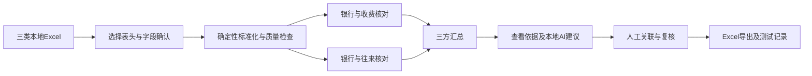

# P14 账务核对平台需求与验收基线

## 结论与目标

面向高校财务处对账岗位，开发本地演示原型，通过文件导入和可追溯核对减少逐行比对、摘抄异常的重复劳动。成功标准是完成三类 Excel 解析清洗、三方匹配与三类清单导出，稳定演示，并提供需求、规则和测试证据。全部结果须人工复核。

依据是项目目录内《P14-账务核对平台-财务资产处.docx》，以及用户提供的深度拆解。申报表第 5—7 项界定核心任务、范围与交付，第 15—17 项界定数据使用和人工复核。正文批注描述两组核对关系，作为待确认线索，不替代正文的三方目标。

## 首版能力

1. 银行、收费、往来三类来源分别导入多份 `.xlsx/.xls`；选择工作表和表头行、预览、确认映射。币种、方向缺失的默认处理显式提示。
2. 保留原始来源与位置，清洗金额、日期、编号；无效行留存并限制自动匹配。
3. 精确编号与明确批次关联，分别建立两组核对关系；汇总已匹配、未匹配、异常差异结果。
4. 本地模型建议非标准字段映射、清洗方式及候选关系；人确认后才改变映射或建立关联。
5. 复核结论与自动分类独立；关联变更后重新计算，新结果重新待复核。
6. 保存当前任务，重启恢复；导出全部依据、原始位置、质量问题和操作记录。

## 工作流

工作区依次为对账总览、导入与字段确认、结果与人工复核、本地 AI 与记录、交付与说明。数据表展示数量时区分原始行数与结果组数。缺失差额显示未知，不显示为零。

## 技术与接口

Python 3.12、Streamlit、Pandas、openpyxl/xlrd、SQLite、Ollama。内部接口为标准记录集合、两组关系结果、三方结果组、复核事件及结构化 AI 建议；没有新增外部业务 API。标准记录包含来源、文件、工作表、行号、业务/批次编号、对象、日期、币种、方向、金额分值、原始内容和质量问题。

匹配规则版本为 `demo-1.0`，任务保存规则快照。AI 固定本机端点；超时、取消、模型缺失或校验失败均保留规则结果。SQLite 只保存一个当前任务，明确确认后才能用新任务替换；不实现多人并发协作或权限认证。

## 验收与边界

申报验收包括样例解析列表与截图、三类清单及导出文件、稳定原型、匹配逻辑与基础测试记录。原文没有量化性能要求，本实现记录指定规模实测数据，不承诺未经约定的 SLA。

不做生产对接、生产上线、凭证制单、自动记账和完整财务系统。开发与测试仅用独立合成数据或经授权的脱敏模拟数据。模型下载完成后业务流程应可离线运行；财务样例不得上传外部 AI 或公网。公开演示只使用独立合成数据。

完整项目还需财务处确认规则、提供样例并完成业务验收。程序测试结果与业务认可分开保存，不能互相替代。

